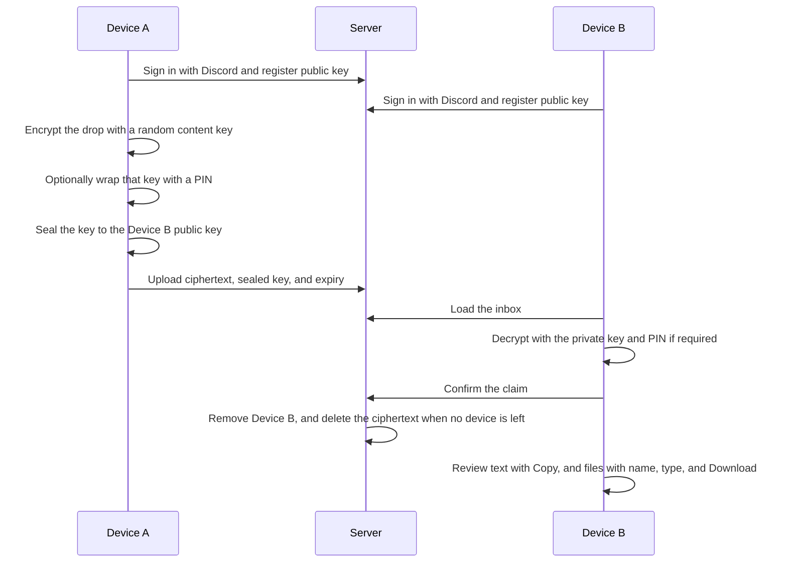

# Ephemera

Version 1 is a burn-after-reading drop for text and files. Two machines that cannot reach each other directly both open this site, sign in with the same Discord account, and hand the payload across. The server stores ciphertext only. Opening a drop removes it from that device. The ciphertext is deleted when every selected device has opened it, or when its timer expires. There is no content backup.

One command builds the browser app and serves it. Discord sign-in, device keys, the recipient check, the compose screen, encrypted upload, the inbox, claiming a drop, the review screen, and the expiry sweep are in place. A push to `main` that passes CI deploys itself. This document defines the version 1 scope, the encryption flow, and the local Discord setup.

## Local

```
npm run dev
```

That installs the browser dependencies, builds them, and serves the build at http://localhost:3000.

## Scope

- Any Discord account can sign in. A drop belongs to that account. Another account cannot open it.
- The first sign-in in a browser creates a device key pair. The private key stays in that browser. The public key is uploaded. The user names the device, for example Desktop or Mac.
- One drop holds multiple text blocks and multiple files of any type. Filenames and contents are encrypted before upload.
- The sender chooses which of this account's other devices receive the drop. Every other device starts selected. Sending is blocked until a second device has signed in and registered a public key.
- Retention defaults to 1 minute and starts when the upload completes. The sender picks a preset or an exact expiry on a date-and-time picker. Presets are 1 minute, 5 minutes, 15 minutes, 1 hour, 1 day, 7 days, and 30 days. There is no maximum.
- A PIN is optional. When set, the receiving browser must enter it before decryption. The PIN is derived in the browser and is never sent to the server.
- A successful decrypt is the claim for that device only. Other selected devices keep the drop until they open it. The ciphertext is deleted when the last selected device claims it. Expiry deletes it for everyone still waiting. A wrong PIN does not delete the drop; the recipient can retry until expiry.
- After decrypt, the recipient gets a review screen and nothing is saved automatically. Each text block is shown in full with a Copy button. Each file is listed with its filename and type, plus a Download button. Copy and download are optional. Closing the page discards whatever is still only in the browser. File bytes are not rendered inline.
- Files are encrypted in chunks. The server cap is `MAX_UPLOAD_MB`, default 1024 (1GB per drop). The operator can raise or lower it. The cap protects disk space.

The server keeps ciphertext, the content key sealed for each target device, the expiry time, the sender device id shown in the inbox, and the public salt used for a PIN. Plaintext, the content key, the PIN, and device private keys stay in the browser. Device public keys and sealed content keys are stored as themselves. Hashing either one would leave the other device unable to open the drop. The Discord client secret stays in the environment and is not written to the database. Sign-in stores the SHA-256 of the session token, not the token. A sweep deletes expired ciphertext and rows. It does not wait for the recipient to open the drop.

## Example workflow

Device A and Device B below are any two browsers signed in to the same Discord account. The sender and the recipient can be a phone, a laptop, or a desktop. The platform does not matter.



Clearing site data, or switching browsers, destroys that device's private key. Drops already sealed for it can no longer be opened. They disappear when they expire.

## Out of scope

- Teams and fan-out to several Discord accounts
- Claim links for someone who is not signed in
- An account allowlist
- File-type restrictions or virus scanning

A drop is sealed to the devices the sender selected. Each device loses it on claim. The ciphertext stays until every selected device has claimed it, or until it expires.

## Environment

Copy this block into `.env`. That file is gitignored and must stay untracked.

```
DISCORD_CLIENT_ID=
DISCORD_CLIENT_SECRET=
DISCORD_PUBLIC_KEY=
AUTH_URL=http://localhost:3000
MAX_UPLOAD_MB=1024
PORT=3000
```

| Variable | Source |
| --- | --- |
| `DISCORD_CLIENT_ID` | OAuth2 Client ID. It is the same value as the Application ID. |
| `DISCORD_CLIENT_SECRET` | OAuth2 Client Secret. It stays in the environment. It is not hashed and not written to SQLite, because Discord must receive the secret itself. |
| `DISCORD_PUBLIC_KEY` | Application public key. Loaded at startup. Sign-in and transfer do not use it, and it is not written to SQLite. |
| `AUTH_URL` | Public origin of this site. Local: `http://localhost:3000`. VPS: `https://your.domain`. |
| `MAX_UPLOAD_MB` | Maximum drop size in megabytes. Default `1024`. |
| `PORT` | Port on `127.0.0.1`. Default `3000`. |

Sign-in is Discord OAuth2 with the `identify` scope only. Do not add a Bot to this application. Leave the OAuth2 URL Generator unused; the site builds the authorize URL itself.

## Local Discord redirect

In the Developer Portal, open the application, then OAuth2, then Redirects. Add the URL below and save. The value must match exactly.

```
http://localhost:3000/api/auth/callback/discord
```

When the same application is used on the VPS, add a second redirect and set `AUTH_URL` on that host to the same origin. The client ID and client secret stay unchanged.

```
https://your.domain/api/auth/callback/discord
```

## Deployment

Version 1 runs on a private VPS. The browser app is Vite, React, and TypeScript. A Node.js server serves that build and handles sign-in, upload, claim, and expiry. It has no decrypt function. It listens on `127.0.0.1`. Metadata is `data/ephemera.sqlite`. Ciphertext files are `data/blobs/<random id>`. Both paths are gitignored. Caddy terminates HTTPS and reverse-proxies to `PORT`.
Leave provider-wide disk snapshots off for the data volume. A snapshot would retain ciphertext after a claim. That ciphertext is still unreadable without the recipient's private key, and it breaks the requirement that a taken drop leave no copy on disk.
